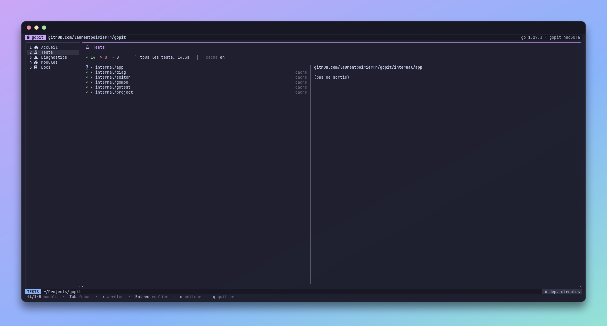

# gopit

[Français](README.md) · **English** · [Español](README.es.md)

The Go developer's cockpit in the terminal.

gopit brings together, in a keyboard (and mouse) interface, what editors do
poorly — following tests, reading diagnostics, exploring dependencies,
browsing documentation. To change code, it has its own built-in editor,
designed for Go; you can also keep your own editor (`$VISUAL` / `$EDITOR`):
File menu → "Open files in external editor".

Built with the [Charm](https://charm.land/) stack: Bubble Tea v2,
Lip Gloss v2.



## Usage

```sh
make build
./bin/gopit ~/Projects/my-module   # or: make run ARGS=~/Projects/my-module
```

gopit walks up from the given directory (the current directory by default)
to the first `go.mod`. If there is none, it offers to create a module
(`go mod init`); the suggested path comes from the git repository
(`git remote`) or the GitHub account (`gh`, `git config github.user`):
`Enter` accepts it, `Tab` lets you edit it.

| Key | Action |
|---|---|
| `↑` `↓` or `1`…`9`, `0` | choose a module |
| `F5` / `Shift+F5` | debug: start, continue (or pause) / stop |
| `F6` `F7` `F8` | step over, step into, step out |
| `F9` | breakpoint on the cursor's line (editor) |
| `Ctrl+P` | command palette: every action of every module |
| `F10` or `Alt` + underlined letter | menu bar |
| `Ctrl+O` / `Ctrl+N` | open / create a project file in the built-in editor |
| `Tab` / `Esc` | switch between navigation and the module |
| `e` | open the external editor on the project |
| `q` / `Ctrl+Q` | quit (asks for confirmation if files are unsaved); `Ctrl+C` quits too, except in the editor where it copies |

## Preferences

Settings (last module shown, coverage, cache, filters, benchmark
repetitions…) are saved on exit in `~/.config/gopit/config.json` and read
back at startup. The benchmark history is stored in `~/.cache/gopit/bench/`.

## Languages

The interface is available in French, English and Spanish. gopit uses the
system language (`LC_ALL`, `LC_MESSAGES` or `LANG`; English for a language
that isn't available). You can change it while running (View menu, or
"Language" in the palette), and the choice is kept in the preferences;
`gopit -lang en` forces it for one session.

## Modules

| Module | Status |
|---|---|
| Home — module summary (Go version, packages, files, git) | ✅ |
| Editor — project tree, several open files, syntax highlighting (Go, go.mod / go.sum, and with chroma Markdown, YAML, Makefile, Dockerfile, JSON, SQL, shell scripts…), automatic indentation, gofmt on save, errors underlined as you type and completion (gopls), find and replace, mouse selection, undo/redo, go to definition and symbol documentation (gopls) | ✅ |
| Tests — live `go test -json`, targeted reruns, open the failure, automatic rerun on save (`w`), coverage per package and per file (`v`) | ✅ |
| Diagnostics — `go vet`, staticcheck, gopls and gofmt, merged, with a code excerpt; rerun on every save in the editor | ✅ |
| Debug — Delve (`dlv dap`): a package's program or tests (target `c`: `.`, `./cmd/tool -- args`, `test ./pkg -run TestX`), breakpoints set in the editor (`F9`, kept between sessions), stepping (`F5` to `F8`) with the current line shown in the editor, call stack (`u` / `d`), expandable variables, program output | ✅ |
| Git — repository status, colored diff, recent commits; stage (`s`, `A`), unstage (`u`), commit (`c`), switch to or create a branch (`b`, or click the branch in the status bar) — no destructive action, no push | ✅ |
| Terminal — shell commands in the project directory (`go build`, `make`, `go run .`…), live output, history, rerun (`r`), stop (`Ctrl+C`), open `file.go:line` locations (`o`); no interactive programs | ✅ |
| Docs — documentation of the module's packages and of the standard library, rendered with Glamour | ✅ |
| Modules — dependencies, updates (`go get` after confirmation), `go mod why`, `govulncheck` | ✅ |
| Benchmarks — `go test -bench`, run history, comparison with a baseline (Δ % and noise), sparkline trend, CPU and memory profiles (`p`, `m`) with annotated source | ✅ |

### Built-in editor

Opening a file from Tests, Diagnostics, Git, Terminal, Docs or Benchmarks (`Enter` /
`o`) shows it in the editor, at the right line. Two modes: **read** (the
cockpit keys stay active) and **edit** (`Enter` or a click; `Esc` to leave).

| Key | Action |
|---|---|
| `Ctrl+S` | save (formatted with gofmt for a Go file) |
| `Ctrl+O` | open a file (search by name) |
| `Ctrl+N` | new file (path relative to the project, subdirectories created as needed; a Go file starts with its `package` line); also `n` in the tree |
| `Ctrl+W` or `Ctrl+F4` | close the file (also: `w` in read mode, the tab's `×`) |
| `Ctrl+B` | show / hide the tree |
| `Ctrl+E` | switch between the text and the tree |
| `Ctrl+PgDn` / `Ctrl+PgUp` | next / previous file |
| `Ctrl+Z` / `Ctrl+Y` | undo / redo |
| `Ctrl+X` / `Ctrl+C` / `Ctrl+V` | cut / copy (the line when nothing is selected) / paste |
| `Ctrl+F`, `F3`, `Shift+F3` | find, next match, previous match |
| `Ctrl+H` or `Ctrl+R` | replace: search text, replacement, then each match (`Enter` replaces, `Space` skips, `a` replaces all, `Esc` stops) |
| `Ctrl+G` | go to line |
| `Tab` / `Shift+Tab` | indent / unindent (selected block) |
| `Ctrl+/` | comment / uncomment |
| `Alt+Shift+F` | format without saving |
| `Ctrl+Space` | completion (gopls), also after a `.`: `↑` `↓` to choose, `Enter` or `Tab` to insert, `Esc` to close |
| `F12` or `Ctrl+]` | go to the definition of the symbol under the cursor (also `d` in read mode) |
| `Ctrl+T` | go back to the position before the jump |
| `Ctrl+K` | documentation of the symbol under the cursor (also `K` in read mode) |

gopls runs in the background as soon as a Go file is open and receives the
text as you type: errors and warnings are underlined (red, yellow, blue),
marked with a `●` in the margin, and the message for the cursor's line is
shown in the status bar. Definitions and documentation take unsaved text
into account. `GOPIT_GOPLS=off` disables the connection; without it, go to
definition uses `gopls definition`, which reads from disk (save first).

In the tree: `↑` `↓` to move, `→` / `←` to expand or collapse a folder,
`Enter` to open, `r` to reload from disk. Open files, expanded folders and
the tree's visibility are restored at the next startup.

## Architecture

```
cmd/gopit/            entry point (options, module detection)
internal/app/         application frame: navigation, bars, focus
internal/panel/       Panel interface shared by all modules
internal/panels/      one package per module (home, code, tests, diagnostics, debug, git, shell, docs, modules, benchmarks)
internal/project/     reading go.mod
internal/theme/       light / dark Catppuccin palette and styles
internal/version/     version injected by the Makefile

Logic without UI (testable on its own):
internal/gotest/      go test -json: running and test state
internal/diag/        go vet, staticcheck, gopls, gofmt: parsing and merging
internal/gomod/       go list -m, go mod why, go get, govulncheck
internal/godoc/       package documentation as Markdown (go/doc)
internal/bench/       go test -bench: parsing, comparison, history
internal/prof/        pprof profiles: cost per function and per line
internal/gitx/        git status / diff / log / add / restore / commit
internal/textbuf/     editor buffer: cursor, selection, undo/redo
internal/dap/         DAP client for "dlv dap": launch, breakpoints, stepping, stack, variables
internal/lsp/         LSP client for "gopls serve": documents, diagnostics, definition, documentation
internal/gopls/       gopls definition: a symbol's definition and documentation (without the connection)
internal/config/      preferences (~/.config/gopit/config.json)
internal/i18n/        interface translation (French → English, Spanish)
internal/cover/       coverage profiles
internal/watch/       watching .go files
internal/editor/      opening $VISUAL / $EDITOR at a given line
```

To add a module: create `internal/panels/<name>` implementing
`panel.Panel`, then register it in `app.New`. A module with text input also
implements `panel.Capturer` to receive every key, `panel.Commander` to show
up in the palette (Ctrl+P) and `panel.Persister` to keep its settings from
one session to the next. Texts are written in French, wrapped in
`i18n.T("…")` where they are displayed, and translated in
`internal/i18n/en.go` and `es.go`; `go test ./internal/i18n` reports any
untranslated message. To open a file, a module returns
`panel.Open(file, line)`: the frame sends it to the built-in or external
editor depending on the preferences.

## Development

```sh
make help     # list of targets
make check    # formatting + go vet + tests
```
