# gopit

[Français](README.md) · [English](README.en.md) · **Español**

El cockpit del desarrollador Go en la terminal.

gopit reúne en una interfaz de teclado (y ratón) lo que los editores hacen
mal: seguir las pruebas, leer los diagnósticos, explorar las dependencias,
consultar la documentación. Para modificar código tiene su propio editor
integrado, pensado para Go; también puedes seguir usando tu editor
(`$VISUAL` / `$EDITOR`): menú Archivo → «Abrir los archivos en el editor
externo».

Construido con la pila [Charm](https://charm.land/): Bubble Tea v2,
Lip Gloss v2.

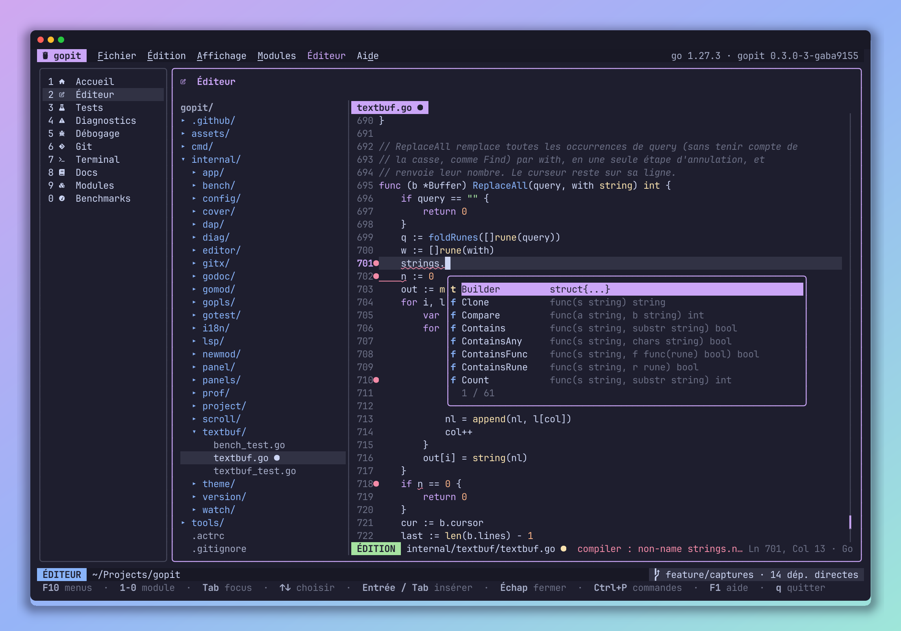

## Capturas de pantalla

gopit sobre su propio repositorio (capturas producidas con `make screenshots`, interfaz en francés):

| | |
|---|---|
| 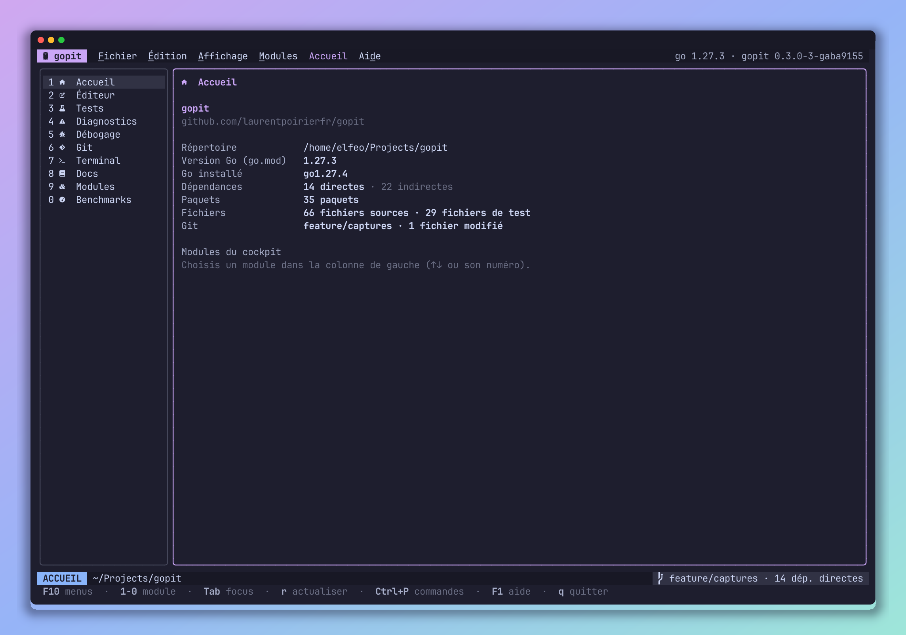<br>Inicio: resumen del módulo | <br>Editor: autocompletado de gopls, error subrayado |
| 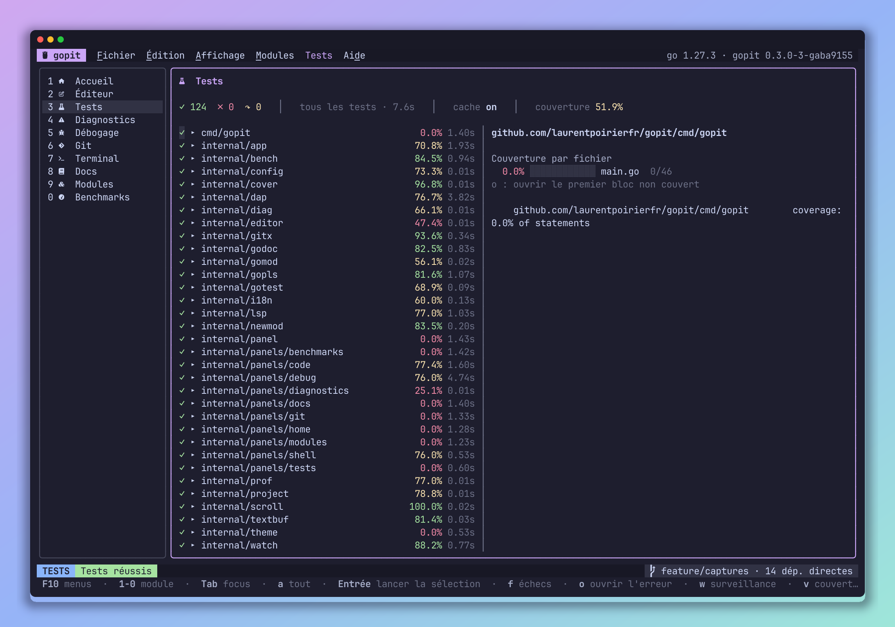<br>Pruebas: resultados en directo y cobertura | 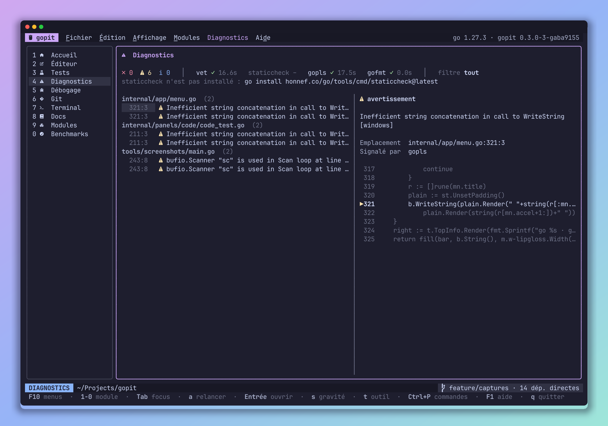<br>Diagnósticos: go vet, gopls, gofmt |
| 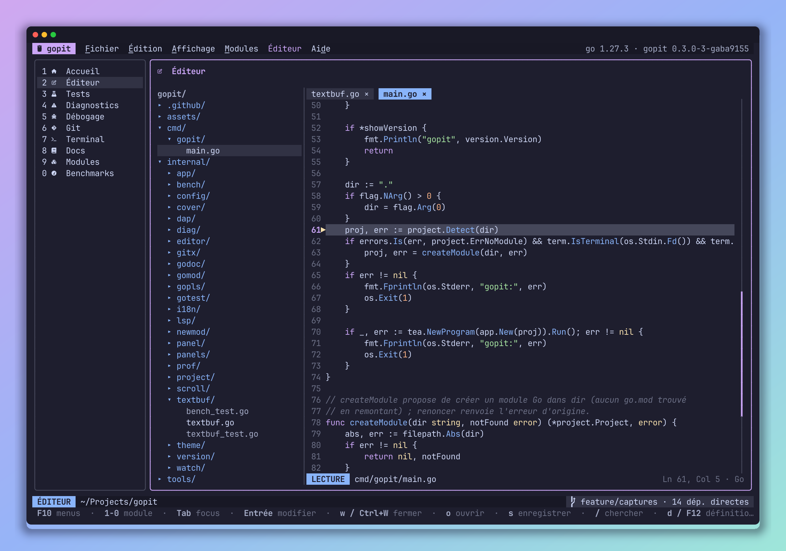<br>Depuración: punto de interrupción alcanzado en el editor | 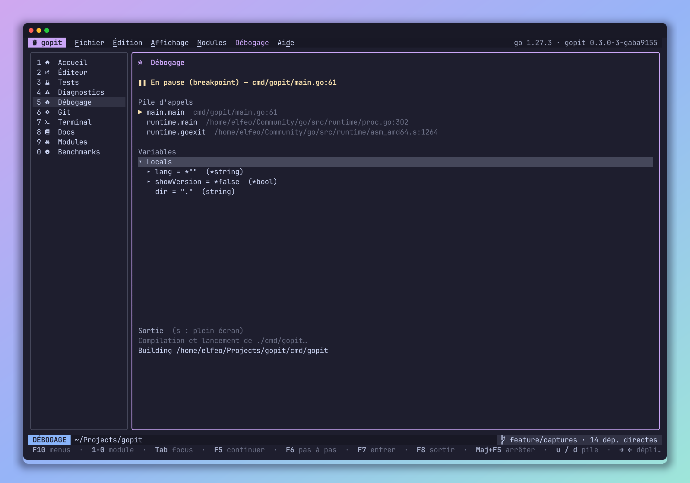<br>Depuración: pila de llamadas y variables |
| 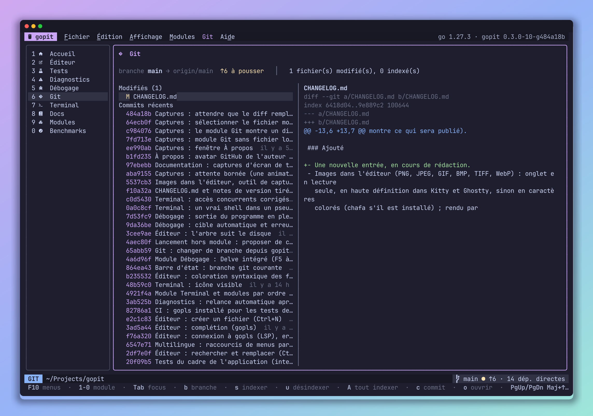<br>Git: estado, diff y commits | 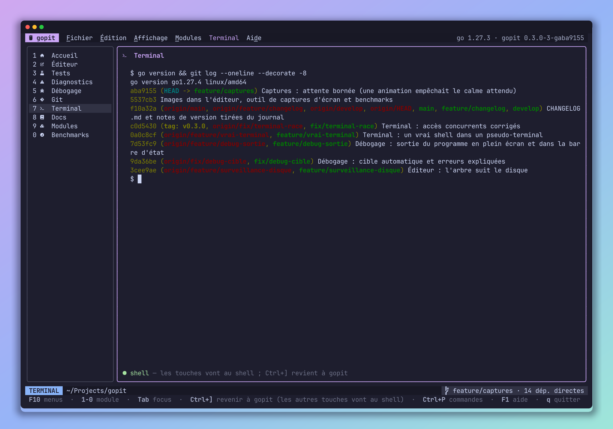<br>Terminal: un shell real |
| 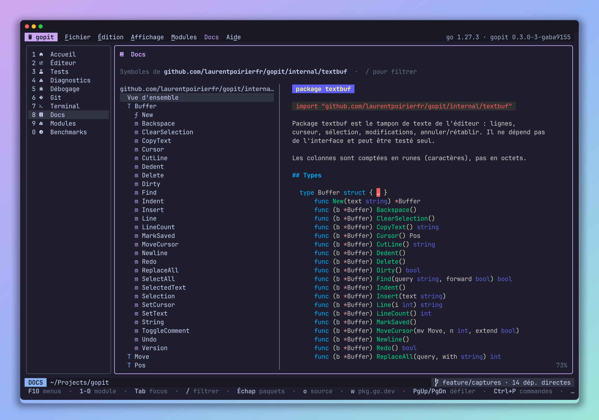<br>Docs: documentación de un paquete | 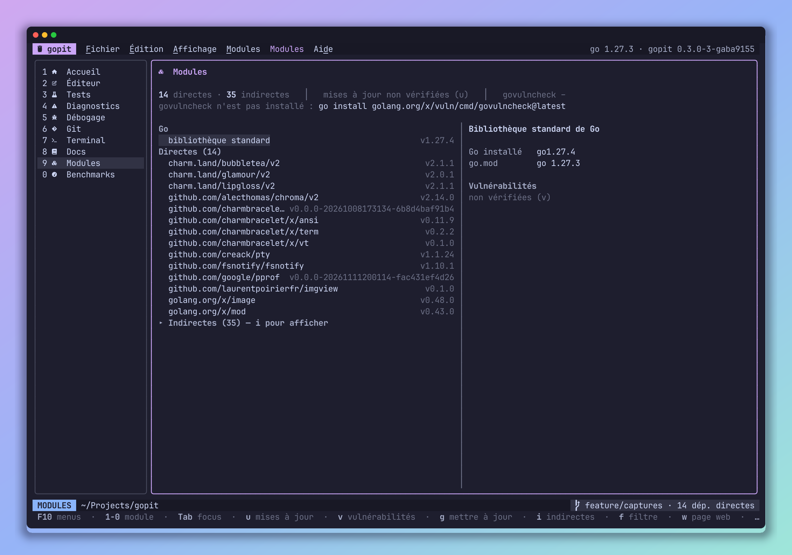<br>Módulos: dependencias |
| 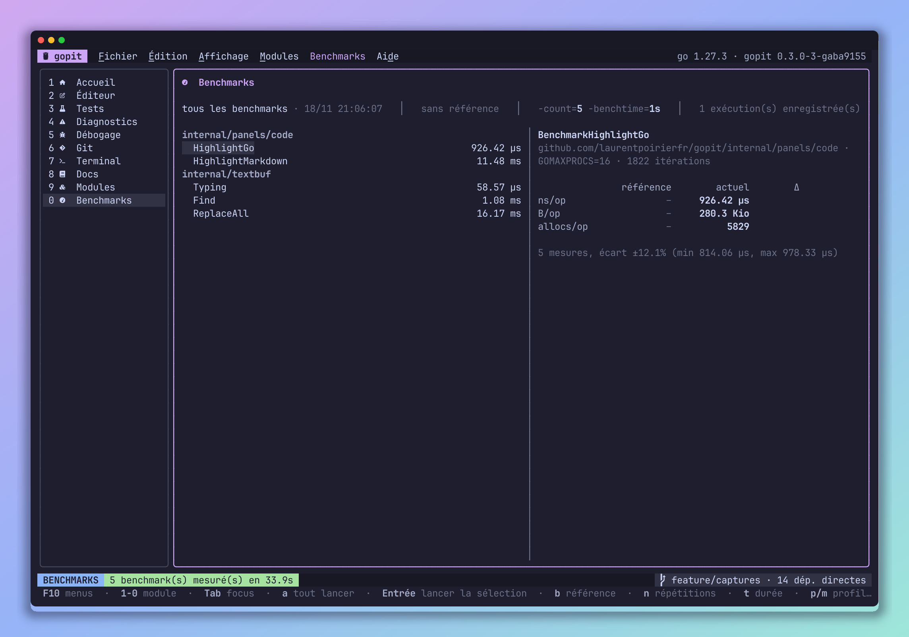<br>Benchmarks: mediciones y comparación | 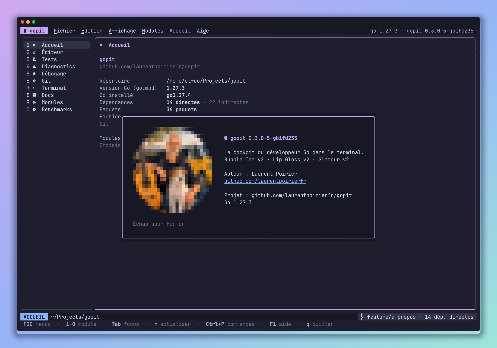<br>Acerca de (menú Ayuda) |

Para regenerarlas: `make screenshots` (requiere una Nerd Font, gopls y Delve).


## Uso

```sh
make build
./bin/gopit ~/Projects/mi-modulo   # o: make run ARGS=~/Projects/mi-modulo
```

gopit sube desde el directorio indicado (por defecto, el directorio actual)
hasta el primer `go.mod`. Si no lo encuentra, propone crear un módulo
(`go mod init`); la ruta propuesta viene del repositorio git
(`git remote`) o de la cuenta de GitHub (`gh`, `git config github.user`):
`Intro` la acepta, `Tab` permite modificarla.

| Tecla | Acción |
|---|---|
| `↑` `↓` o `1`…`9`, `0` | elegir un módulo |
| `F5` / `Mayús+F5` | depurar: iniciar, continuar (o pausar) / detener |
| `F6` `F7` `F8` | paso a paso: por encima, entrar en la función, salir |
| `F9` | punto de interrupción en la línea del cursor (editor) |
| `Ctrl+P` | paleta de comandos: todas las acciones de todos los módulos |
| `F10` o `Alt` + letra subrayada | barra de menús |
| `Ctrl+O` / `Ctrl+N` | abrir / crear un archivo del proyecto en el editor integrado |
| `Tab` / `Esc` | pasar de la navegación al módulo y viceversa |
| `e` | abrir el editor externo en el proyecto |
| `q` / `Ctrl+Q` | salir (pide confirmación si quedan archivos sin guardar); `Ctrl+C` también sale, salvo en el editor, donde copia |

**Con el ratón** también se puede hacer todo: un clic en un módulo de la
columna izquierda lo muestra; en las listas (diagnósticos, tests, paquetes
y símbolos de la documentación, archivos y commits de Git, dependencias,
benchmarks, pila de llamadas y variables del depurador, paleta), un clic
elige la línea y un doble clic actúa como `Intro` (abrir, ejecutar,
desplegar); la rueda desplaza la lista o el panel bajo el ratón. Los
elementos del resumen en la parte superior de los módulos (filtro, caché,
cobertura, referencia, rama…) cambian con un clic, y en la pantalla de
inicio, las líneas marcadas con `→` llevan a su módulo.

## Preferencias

Los ajustes (último módulo mostrado, cobertura, caché, filtros, repeticiones
de los benchmarks…) se guardan al salir en `~/.config/gopit/config.json` y
se leen al arrancar. El historial de los benchmarks se guarda en
`~/.cache/gopit/bench/`.

## Idiomas

La interfaz está disponible en francés, inglés y español. gopit usa el
idioma del sistema (`LC_ALL`, `LC_MESSAGES` o `LANG`; inglés si el idioma no
está disponible). Se puede cambiar durante la ejecución (menú Ver, o
«Idioma» en la paleta) y la elección se guarda en las preferencias;
`gopit -lang es` lo impone para una sesión.

## Módulos

| Módulo | Estado |
|---|---|
| Inicio — resumen del módulo (versión de Go, paquetes, archivos, git) | ✅ |
| Editor — árbol del proyecto, varios archivos abiertos, coloreado de sintaxis (Go, go.mod / go.sum y, con chroma, Markdown, YAML, Makefile, Dockerfile, JSON, SQL, scripts de shell…), indentación automática, gofmt al guardar, errores subrayados mientras escribes y autocompletado (gopls), buscar y reemplazar, selección con el ratón, deshacer/rehacer, imágenes (PNG, JPEG, GIF, WebP… en alta definición en Kitty y Ghostty), ir a la definición y documentación de los símbolos (gopls) | ✅ |
| Pruebas — `go test -json` en directo, relanzamiento selectivo, apertura del error, relanzamiento automático al guardar (`w`), cobertura por paquete y por archivo (`v`) | ✅ |
| Diagnósticos — `go vet`, staticcheck, gopls y gofmt, combinados, con extracto del código; se relanzan con cada guardado en el editor. **Corrección propuesta** por gopls (con sus análisis staticcheck) o gofmt, con vista previa antes/después: `f` la aplica en el editor (sin guardar, `Ctrl+Z` la deshace), `n` pasa a la siguiente. **Por qué**: la documentación de la regla, con sus ejemplos, y `w` para la página en línea; `Mayús+↑↓` o la rueda desplazan el detalle | ✅ |
| Depuración — Delve (`dlv dap`): programa o pruebas de un paquete (objetivo automático: el programa o las pruebas del archivo mostrado, si no el programa del módulo, a elegir si hay varios; `c` para imponerlo: `./cmd/herramienta -- args`, `test ./pkg -run TestX`), puntos de interrupción puestos en el editor (`F9`, conservados de una sesión a otra), paso a paso (`F5` a `F8`) con la línea actual en el editor, pila de llamadas (`u` / `d`), variables desplegables, salida del programa (`s`: pantalla completa con desplazamiento; fuera del módulo, cada línea escrita aparece en la barra de estado); el programa no recibe el teclado (una aplicación a pantalla completa no se depura así) | ✅ |
| Git — estado del repositorio, diff en color, commits recientes; indexar (`s`, `A`), desindexar (`u`), hacer commit (`c`), cambiar de rama o crear una (`b`, o clic en la rama de la barra de estado), sin acciones destructivas ni push | ✅ |
| Terminal — un shell real (`$SHELL`) en un pseudoterminal, en el directorio del proyecto: programas interactivos (vim, htop, `git rebase -i`…), colores, redimensionado. Todas las teclas van al shell (`Ctrl+C`, `Ctrl+Q` y teclas F incluidas); `Ctrl+]` devuelve el control a gopit (navegación: historial de la pantalla, `o` abre el `archivo.go:línea` de la línea elegida, `i` vuelve al shell). `GOPIT_TERMINAL=off` lo desactiva; aún no en Windows | ✅ |
| Docs — documentación de los paquetes del módulo y de la biblioteca estándar, mostrada con Glamour | ✅ |
| Módulos — dependencias, actualizaciones (`go get` tras confirmación), `go mod why`, `govulncheck` | ✅ |
| Benchmarks — `go test -bench`, historial de ejecuciones, comparación con una referencia (Δ % y ruido), evolución en sparkline, perfiles de CPU y memoria (`p`, `m`) con código fuente anotado | ✅ |

### Editor integrado

Abrir un archivo desde Pruebas, Diagnósticos, Git, Terminal, Docs o Benchmarks
(`Intro` / `o`) lo muestra en el editor, en la línea correcta. Dos modos:
**lectura** (las teclas del cockpit siguen activas) y **edición** (`Intro`
o un clic; `Esc` para salir).

| Tecla | Acción |
|---|---|
| `Ctrl+S` | guardar; en un archivo Go, imports organizados por gopls (se añaden los que faltan y se quitan los que sobran, como goimports; desactivable desde la paleta) y luego gofmt, en un solo paso de deshacer |
| `Ctrl+O` | abrir un archivo (búsqueda por nombre) |
| `Ctrl+N` | nuevo archivo (ruta relativa al proyecto, subdirectorios creados si hace falta; un archivo Go empieza por su línea `package`); también `n` en el árbol |
| `Ctrl+W` o `Ctrl+F4` | cerrar el archivo (también: `w` en lectura, la `×` de la pestaña) |
| `Ctrl+B` | mostrar / ocultar el árbol |
| `Ctrl+E` | pasar del texto al árbol y viceversa |
| `Ctrl+PgDn` / `Ctrl+PgUp` | archivo siguiente / anterior |
| `Ctrl+Z` / `Ctrl+Y` | deshacer / rehacer |
| `Ctrl+X` / `Ctrl+C` / `Ctrl+V` | cortar / copiar / pegar; sin selección, la línea entera, pegada encima de la línea del cursor y reindentada |
| `Alt+↑` / `Alt+↓` | mover la línea (o las líneas seleccionadas) |
| `Mayús+Alt+↓` / `Mayús+Alt+↑` | duplicar la línea (o las líneas seleccionadas) |
| `Ctrl+Mayús+K` | eliminar la línea |
| `Ctrl+L` | seleccionar la línea (otra vez: la siguiente); doble clic: la palabra, triple clic: la línea |
| `Ctrl+Intro` / `Ctrl+Mayús+Intro` | nueva línea debajo / encima, esté donde esté el cursor |
| `Ctrl+Retroceso` / `Ctrl+Supr` | borrar la palabra antes / después del cursor (también `Alt+…`) |
| `(` `[` `{` `"` `` ` `` | se cierran automáticamente (desactivable desde la paleta); sobre una selección, la rodean; `Intro` entre `{}` abre un bloque |
| `Ctrl+M` | ir al paréntesis correspondiente (resaltado junto con el del cursor) |
| `Ctrl+F`, `F3`, `Mayús+F3` | buscar, coincidencia siguiente, anterior |
| `Ctrl+H` o `Ctrl+R` | reemplazar: texto buscado, reemplazo y luego cada coincidencia (`Intro` reemplaza, `Espacio` omite, `a` reemplaza todo, `Esc` termina) |
| `Ctrl+G` | ir a la línea |
| `Tab` / `Mayús+Tab` | indentar / desindentar (bloque seleccionado) |
| `Ctrl+/` | comentar / descomentar |
| `Alt+Mayús+F` | formatear sin guardar |
| `Alt+Mayús+O` | organizar los imports sin guardar |
| `Ctrl+Espacio` | autocompletado (gopls), también tras un `.`: `↑` `↓` para elegir, `Intro` o `Tab` para insertar, `Esc` para cerrar |
| `F12` o `Ctrl+]` | ir a la definición del símbolo bajo el cursor (también `d` en lectura) |
| `Ctrl+T` | volver a la posición anterior al salto |
| `Ctrl+K` | documentación del símbolo bajo el cursor (también `K` en lectura) |

gopls se ejecuta en segundo plano en cuanto se abre un archivo Go y recibe
el texto mientras escribes: los errores y advertencias se subrayan (rojo,
amarillo, azul), se marcan con un `●` en el margen y el mensaje de la línea
del cursor aparece en la barra de estado. La definición y la documentación
tienen en cuenta el texto sin guardar. `GOPIT_GOPLS=off` desactiva la
conexión; sin ella, la definición usa `gopls definition`, que lee el disco
(hay que guardar antes).

Una imagen (PNG, JPEG, GIF, BMP, TIFF, WebP) se abre en una pestaña de solo
lectura, con su formato, sus dimensiones y su tamaño en la barra de estado:
en alta definición en Kitty y Ghostty (protocolo gráfico de Kitty), si no en
caracteres de color (con [chafa](https://hpjansson.org/chafa/) si está
instalado). El renderizado viene de
[imgview](https://github.com/laurentpoirierfr/imgview);
`IMGVIEW_NO_KITTY=1` desactiva la alta definición.

En el árbol: `↑` `↓` para moverse, `→` / `←` para desplegar o plegar una
carpeta, `Intro` para abrir. El árbol sigue al disco: un archivo o carpeta creado,
borrado o renombrado en otro lugar (terminal, otro editor, git) aparece por
sí solo, y un archivo abierto sin modificar se relee si cambia
(`GOPIT_WATCH=off` desactiva esta vigilancia; `r` relee el árbol). Los archivos
abiertos, las carpetas desplegadas y la visibilidad del árbol se recuperan
en el siguiente arranque.

## Arquitectura

```
cmd/gopit/            punto de entrada (opciones, detección del módulo)
internal/app/         marco de la aplicación: navegación, barras, foco
internal/panel/       interfaz Panel común a todos los módulos
internal/panels/      un paquete por módulo (home, code, tests, diagnostics, debug, git, shell, docs, modules, benchmarks)
internal/project/     lectura de go.mod
internal/theme/       paleta Catppuccin clara / oscura y estilos
internal/version/     versión inyectada por el Makefile

Lógica sin interfaz (comprobable por sí sola):
internal/gotest/      go test -json: ejecución y estado de las pruebas
internal/diag/        go vet, staticcheck, gopls, gofmt: lectura y combinación
internal/gomod/       go list -m, go mod why, go get, govulncheck
internal/godoc/       documentación de un paquete en Markdown (go/doc)
internal/bench/       go test -bench: lectura, comparación, historial
internal/prof/        perfiles pprof: coste por función y por línea
internal/gitx/        git status / diff / log / add / restore / commit
internal/textbuf/     búfer del editor: cursor, selección, deshacer/rehacer
internal/dap/         cliente DAP de «dlv dap»: lanzamiento, puntos de interrupción, paso a paso, pila, variables
internal/lsp/         cliente LSP de «gopls serve»: documentos, diagnósticos, definición, documentación
internal/gopls/       gopls definition: definición y documentación de un símbolo (sin conexión)
internal/config/      preferencias (~/.config/gopit/config.json)
internal/i18n/        traducción de la interfaz (francés → inglés, español)
internal/cover/       perfiles de cobertura
internal/watch/       vigilancia de los archivos .go
internal/editor/      apertura de $VISUAL / $EDITOR en una línea dada
```

Para añadir un módulo: crear `internal/panels/<nombre>` que implemente
`panel.Panel` y registrarlo en `app.New`. Un módulo con entrada de texto
implementa también `panel.Capturer` para recibir todas las teclas,
`panel.Commander` para aparecer en la paleta (Ctrl+P) y `panel.Persister`
para conservar sus ajustes de una sesión a otra. Para el ratón, envuelve al
dibujar lo que se puede pulsar con `panel.Zone` (o `panel.Row` para una
línea de lista) y recibe en `panel.ClickMsg` y `panel.WheelMsg` las zonas
bajo el ratón, sin calcular su disposición. Los textos se escriben en
francés, envueltos en `i18n.T("…")` donde se muestran, y se traducen en
`internal/i18n/en.go` y `es.go`; `go test ./internal/i18n` señala cualquier
mensaje sin traducir. Para abrir un archivo, un módulo devuelve
`panel.Open(archivo, línea)`: el marco lo envía al editor integrado o
externo según las preferencias.

## Desarrollo

```sh
make help     # lista de objetivos
make check    # formato + go vet + pruebas
```

Los cambios de cada versión se registran (en francés) en
[CHANGELOG.md](CHANGELOG.md): añade los tuyos bajo «Non publié»; la sección
de la versión se usa como notas de versión en GitHub
(`make release-notes TAG=vX.Y.Z` para revisarla antes de crear el tag).
