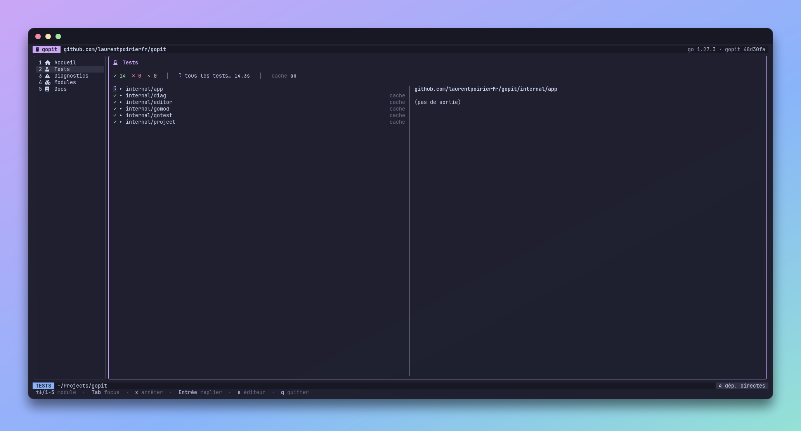

# gopit

**Français** · [English](README.en.md) · [Español](README.es.md)

Le cockpit du développeur Go dans le terminal.

gopit rassemble dans une interface clavier (et souris) ce que les éditeurs
font mal — suivre les tests, lire les diagnostics, explorer les dépendances,
consulter la documentation. Pour modifier du code, il a son propre éditeur
intégré, pensé pour Go ; tu peux aussi garder ton éditeur (`$VISUAL` /
`$EDITOR`) : menu Fichier → « Ouvrir les fichiers dans l'éditeur externe ».

Construit avec la pile [Charm](https://charm.land/) : Bubble Tea v2,
Lip Gloss v2.



## Utilisation

```sh
make build
./bin/gopit ~/Projects/mon-module   # ou : make run ARGS=~/Projects/mon-module
```

gopit remonte depuis le répertoire donné (par défaut le répertoire courant)
jusqu'au premier `go.mod`. S'il n'en trouve pas, il propose de créer un
module (`go mod init`) ; le chemin proposé vient du dépôt git
(`git remote`) ou du compte GitHub (`gh`, `git config github.user`) :
`Entrée` l'accepte, `Tab` permet de le modifier.

| Touche | Action |
|---|---|
| `↑` `↓` ou `1`…`9`, `0` | choisir un module |
| `F5` / `Maj+F5` | déboguer : lancer, continuer (ou interrompre) / arrêter |
| `F6` `F7` `F8` | pas à pas : principal, entrer dans la fonction, en sortir |
| `F9` | point d'arrêt sur la ligne du curseur (éditeur) |
| `Ctrl+P` | palette de commandes : toutes les actions de tous les modules |
| `F10` ou `Alt` + lettre soulignée | barre de menus |
| `Ctrl+O` / `Ctrl+N` | ouvrir / créer un fichier du projet dans l'éditeur intégré |
| `Tab` / `Échap` | passer de la navigation au module et inversement |
| `e` | ouvrir l'éditeur externe sur le projet |
| `q` / `Ctrl+Q` | quitter (confirmation s'il reste des fichiers non enregistrés) ; `Ctrl+C` quitte aussi, sauf dans l'éditeur où il copie |

## Préférences

Les réglages (dernier module affiché, couverture, cache, filtres,
répétitions des benchmarks…) sont enregistrés en quittant dans
`~/.config/gopit/config.json` et relus au démarrage. L'historique des
benchmarks est rangé dans `~/.cache/gopit/bench/`.

## Langues

L'interface existe en français, en anglais et en espagnol. gopit prend la
langue du système (`LC_ALL`, `LC_MESSAGES` ou `LANG` ; anglais pour une
langue non disponible). On peut la changer pendant l'exécution (menu
Affichage, ou « Langue » dans la palette), et ce choix est retenu dans les
préférences ; `gopit -lang en` l'impose pour une session.

## Modules

| Module | État |
|---|---|
| Accueil — résumé du module (version Go, paquets, fichiers, git) | ✅ |
| Éditeur — arborescence du projet, plusieurs fichiers ouverts, coloration syntaxique (Go, go.mod / go.sum, et avec chroma Markdown, YAML, Makefile, Dockerfile, JSON, SQL, scripts shell…), indentation automatique, gofmt à l'enregistrement, erreurs soulignées pendant la frappe et complétion (gopls), recherche et remplacement, sélection à la souris, annuler/rétablir, aller à la définition et documentation des symboles (gopls) | ✅ |
| Tests — `go test -json` en direct, relance ciblée, ouverture de l'erreur, relance automatique à l'enregistrement (`w`), couverture par paquet et par fichier (`v`) | ✅ |
| Diagnostics — `go vet`, staticcheck, gopls et gofmt, fusionnés, avec extrait du code ; relancés à chaque enregistrement dans l'éditeur | ✅ |
| Débogage — Delve (`dlv dap`) : programme ou tests d'un paquet (cible `c` : `.`, `./cmd/outil -- args`, `test ./pkg -run TestX`), points d'arrêt posés dans l'éditeur (`F9`, gardés d'une session à l'autre), pas à pas (`F5` à `F8`) avec la ligne courante dans l'éditeur, pile d'appels (`u` / `d`), variables dépliables, sortie du programme | ✅ |
| Git — état du dépôt, diff coloré, commits récents ; indexer (`s`, `A`), désindexer (`u`), commiter (`c`), changer de branche ou en créer une (`b`, ou clic sur la branche dans la barre d'état) — sans action destructive ni push | ✅ |
| Terminal — commandes du shell dans le répertoire du projet (`go build`, `make`, `go run .`…), sortie en direct, historique, relance (`r`), arrêt (`Ctrl+C`), ouverture des `fichier.go:ligne` (`o`) ; pas de programme interactif | ✅ |
| Docs — documentation des paquets du module et de la bibliothèque standard, rendue avec Glamour | ✅ |
| Modules — dépendances, mises à jour (`go get` après confirmation), `go mod why`, `govulncheck` | ✅ |
| Benchmarks — `go test -bench`, historique des exécutions, comparaison avec une référence (Δ % et bruit), évolution en sparkline, profils CPU et mémoire (`p`, `m`) avec code source annoté | ✅ |

### Éditeur intégré

Ouvrir un fichier depuis Tests, Diagnostics, Git, Terminal, Docs ou Benchmarks
(`Entrée` / `o`) l'affiche dans l'éditeur, à la bonne ligne. Deux modes :
**lecture** (les touches du cockpit restent actives) et **édition** (`Entrée`
ou un clic ; `Échap` pour en sortir).

| Touche | Action |
|---|---|
| `Ctrl+S` | enregistrer (formaté avec gofmt pour un fichier Go) |
| `Ctrl+O` | ouvrir un fichier (recherche par nom) |
| `Ctrl+N` | nouveau fichier (chemin relatif au projet, sous-répertoires créés au besoin ; un fichier Go commence par sa ligne `package`) ; aussi `n` dans l'arborescence |
| `Ctrl+W` ou `Ctrl+F4` | fermer le fichier (aussi : `w` en lecture, la croix `×` de l'onglet) |
| `Ctrl+B` | afficher / masquer l'arborescence |
| `Ctrl+E` | passer du texte à l'arborescence et inversement |
| `Ctrl+PgDn` / `Ctrl+PgUp` | fichier suivant / précédent |
| `Ctrl+Z` / `Ctrl+Y` | annuler / rétablir |
| `Ctrl+X` / `Ctrl+C` / `Ctrl+V` | couper / copier (la ligne sans sélection) / coller |
| `Ctrl+F`, `F3`, `Maj+F3` | rechercher, occurrence suivante, précédente |
| `Ctrl+H` ou `Ctrl+R` | remplacer : texte cherché, remplacement, puis chaque occurrence (`Entrée` remplace, `Espace` passe, `a` remplace tout, `Échap` termine) |
| `Ctrl+G` | aller à la ligne |
| `Tab` / `Maj+Tab` | indenter / désindenter (bloc sélectionné) |
| `Ctrl+/` | commenter / décommenter |
| `Alt+Maj+F` | formater sans enregistrer |
| `Ctrl+Espace` | complétion (gopls), aussi après un `.` : `↑` `↓` pour choisir, `Entrée` ou `Tab` pour insérer, `Échap` pour fermer |
| `F12` ou `Ctrl+]` | aller à la définition du symbole sous le curseur (aussi `d` en lecture) |
| `Ctrl+T` | revenir à la position d'avant le saut |
| `Ctrl+K` | documentation du symbole sous le curseur (aussi `K` en lecture) |

gopls tourne en arrière-plan dès qu'un fichier Go est ouvert et reçoit le
texte au fil de la frappe : les erreurs et avertissements sont soulignés
(rouge, jaune, bleu), marqués d'un `●` dans la marge, et le message de la
ligne du curseur s'affiche dans la barre d'état. La définition et la
documentation tiennent compte du texte non enregistré. `GOPIT_GOPLS=off`
désactive la connexion ; sans elle, la définition passe par
`gopls definition`, qui lit le disque (il faut alors enregistrer d'abord).

Dans l'arborescence : `↑` `↓` pour naviguer, `→` / `←` pour déplier ou
replier un dossier, `Entrée` pour ouvrir, `r` pour relire le disque. Les
fichiers ouverts, les dossiers dépliés et l'affichage de l'arborescence sont
retrouvés au démarrage suivant.

## Architecture

```
cmd/gopit/            point d'entrée (options, détection du module)
internal/app/         cadre de l'application : navigation, barres, focus
internal/panel/       interface Panel commune à tous les modules
internal/panels/      un paquet par module (home, code, tests, diagnostics, debug, git, shell, docs, modules, benchmarks)
internal/project/     lecture de go.mod
internal/theme/       palette Catppuccin claire / sombre et styles
internal/version/     version injectée par le Makefile

Logique sans interface (testable seule) :
internal/gotest/      go test -json : exécution et état des tests
internal/diag/        go vet, staticcheck, gopls, gofmt : lecture et fusion
internal/gomod/       go list -m, go mod why, go get, govulncheck
internal/godoc/       documentation d'un paquet en Markdown (go/doc)
internal/bench/       go test -bench : lecture, comparaison, historique
internal/prof/        profils pprof : coût par fonction et par ligne
internal/gitx/        git status / diff / log / add / restore / commit
internal/textbuf/     tampon de l'éditeur : curseur, sélection, annuler/rétablir
internal/dap/         client DAP de « dlv dap » : lancement, points d'arrêt, pas à pas, pile, variables
internal/lsp/         client LSP de « gopls serve » : documents, diagnostics, définition, documentation
internal/gopls/       gopls definition : définition et documentation d'un symbole (sans connexion)
internal/config/      préférences (~/.config/gopit/config.json)
internal/i18n/        traduction de l'interface (français → anglais, espagnol)
internal/cover/       profils de couverture
internal/watch/       surveillance des fichiers .go
internal/editor/      ouverture de $VISUAL / $EDITOR à une ligne donnée
```

Ajouter un module : créer `internal/panels/<nom>` qui implémente
`panel.Panel`, puis l'enregistrer dans `app.New`. Un module qui a une saisie
de texte implémente aussi `panel.Capturer` pour recevoir toutes les touches,
`panel.Commander` pour apparaître dans la palette (Ctrl+P) et
`panel.Persister` pour garder ses réglages d'une session à l'autre.
Les textes s'écrivent en français, entourés de `i18n.T("…")` au moment de
les afficher, et se traduisent dans `internal/i18n/en.go` et `es.go` ;
`go test ./internal/i18n` signale tout message sans traduction.
Pour ouvrir un fichier, un module renvoie `panel.Open(fichier, ligne)` : le
cadre l'envoie à l'éditeur intégré ou externe selon les préférences.

## Développement

```sh
make help     # liste des cibles
make check    # formatage + go vet + tests
```
